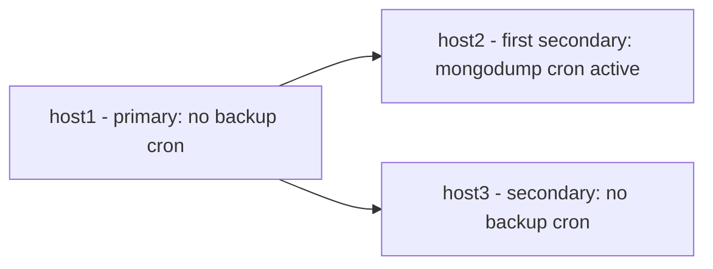
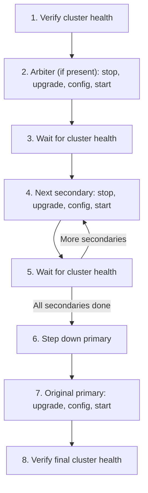

# MongoDB

An Ansible role that installs, configures and manages MongoDB for EL 8 and EL 9.  

> [!NOTE]
> This role is inspired by [csuka/ansible_role_mongodb](https://github.com/csuka/ansible_role_mongodb).

## Deployment Warning

**Please read this file carefully before deploying this Ansible role**

> [!NOTE]
> This role is located in `roles/mongod`. Ensure your `roles_path` is configured to include this directory.

## Functionalities

- Applies recommended production notes, e.g. [numa](https://docs.mongodb.com/manual/administration/production-notes/#configuring-numa-on-linux)
  and [disables transparent hugepages](https://docs.mongodb.com/manual/tutorial/transparent-huge-pages/)
- Bootstrapping a replica set in a PSA (primary, secondary, arbiter) or PSS (primary, secondary, secondary) architecture
  - includes cluster verification
- Orchestrating a Sharded Cluster (Config Servers, Shards, mongos)
- Automated self-signed TLS/SSL certificate generation (`mongodb_tls_generate_certs`)
- Secures intra-cluster communication via an auto-generated keyfile
- Install either Community (`org`) or Enterprise (`enterprise`) edition
- Declarative `/etc/mongod.conf` dictionary configuration
- Update playbook supporting patch releases (`playbooks/update.yml`)
- Add user defined users and databases
- Backup with `mongodump` via cron
- Logrotation references from MongoDB docs

See [Documentation Index](docs/index.md) and [Role Parameters](documentation/PARAMETERS.md) for the complete Diataxis documentation suite.

## Requirements

- Brain
- On the controller node, ensure the
  [mongodb collection](https://docs.ansible.com/ansible/latest/collections/community/mongodb/index.html)
  is installed
- The hosts are able to connect to each other, with preferably hostnames, and
  the set port, default 27017
- Keep in mind there is enough disk space for data disk, and the backup if set

## Assertions

There are several assertions to ensure a minimal valid configuration. Of course,
it does not cover every use case, but most of them.
Please follow this readme carefully. As a hint, for valid a configuration, see
the variables files in the molecule folder.

## Versioning and edition

The version and edition can be set. By default, the official mongodb repository and gpg key are added.

```yaml
mongodb_repo: true
mongodb_version: 6.0
mongodb_edition: org  # or enterprise
mongodb_pymongo_version: 4.7.2
```

## Recommendations

This section refers to this
[official production notes of MongoDB](https://docs.mongodb.com/manual/administration/production-checklist-operations/#linux).

This role includes several configuration recommendations, but not all. There is
for example: "Turn off atime for the storage volume containing the database
files." Such tasks are out of scope for this role.

There are tasks which this role does apply if set, these are:

- Start MongoDB with numactl, set in systemd file
- Disabling zone reclaim
- Disabling transparent hugepages
- Configure tuned profile

See `roles/mongod/tasks/thp.yml` and `roles/mongod/tasks/numa.yml` for the actual changes to the system.

These configuration recommendations are applied by default.

```yaml
mongodb_thp: true
mongodb_numa: true
```

## Configuration variables

First, see `roles/mongod/defaults/main.yml`.

The configuration file is placed at `/etc/mongod.conf`.

The values set in the Ansible configuration are set **exactly** to the
configuration file on the host. Only the keys are pre-defined. Example:

```yaml
# Variable set in Ansible configuration
mongodb_operationprofiling:
  my_Value:
    anotherValue: something
```

Will result in the configuration file on disk:

```yaml
operationProfiling:
  my_Value:
    anotherValue: something
```

If the key is set to an empty string, it will be commented out on the configuration file on disk.

The possible keys to set are:

```yaml
mongodb_systemlog
mongodb_storage
mongodb_processmanagement
mongodb_security
mongodb_operationprofiling
mongodb_replication
mongodb_sharding
mongodb_auditlog
mongodb_snmp
```

There are pre-defined values, which are default for Mongo.
If for some reason, it is desired to set custom key/values, use:

```yaml
mongodb_custom_cnf:
  my_key:
    my_value: true
```

## Authorization

By design there are 3 users created: `admin`, `backup` and `adminuser`.
The admin has role root, the backup user has role backup and adminuser has
role userAdminAnyDatabase.

```yaml
mongodb_admin_pass: 'change_me'
mongodb_adminuser_name: adminuser
mongodb_adminuser_pass: 'change_me'
```

## Databases and users

Taken from
[the docs](https://docs.ansible.com/ansible/latest/collections/community/mongodb/mongodb_user_module.html),
define your own set of users/databases.

See the docs for [the possible roles](https://docs.mongodb.com/manual/reference/built-in-roles/).

Users and databases are always configured via localhost, via user admin and
database admin.
When a cluster configured, configuring database and users is executed from the
primary host.

Set with:

```yaml
mongodb_user:
# in it's most simple form
  - database: my_db
    name: my_user

# standard values
  - database: another_db
    name: another_user
    update_password: on_create
    password: "123ABC!PASSWORD_XYZ"
    roles: 'readWrite,dbAdmin,userAdmin'
    state: present

# all possible variables
  - database: my_db
    name: someone
    password: my_password
    update_password: on_create             # default always
    roles: 'readWrite,dbAdmin,userAdmin'   # default omitted
    state: absent                          # default present
    ssl: true                              # default omitted
    ssl_ca_certs: /path/to/ca_certs        # default omitted
    ssl_cert_reqs: CERT_REQUIRED           # default omitted
    ssl_certfile: /path/to/ssl_certfile    # default omitted
    ssl_crlfile: /path/to/ssl_crlfile      # default omitted
    ssl_keyfile: /path/to/ssl_keyfile      # default omitted
    ssl_pem_passphrase: 'something'        # default omitted
    auth_mechanism: PLAIN                  # default omitted
    connection_options: my_conn_options    # default omitted
    create_for_localhost_exception: value  # default omitted
```

To keep the role idempotent, you should set the value for `update_password` to
`on_create`. Only when actually updating a password, set it to `always`, then
switch back to `on_create`.

## Clustering

When there are multiple hosts in the play, Ansible assumes clustering is
configured.

Clustering in a PSA (primary/secondary/arbiter) architecture is possible, or a
primary/secondary/secondary setup.

For security reasons, the connection between the hosts is secured with a
keyfile.

The [keyfile is automatically generated and deemed secure](https://docs.mongodb.com/manual/tutorial/enforce-keyfile-access-control-in-existing-replica-set/).

```yaml
mongodb_security:
  keyFile: /etc/keyfile_mongo
```

A 2 host cluster is a fundamentally broken design, as it cannot maintain
uptime without a quorum and the ability of a node to go down to aid recovery.
When there are exactly 2 hosts in the play, forming a cluster is not possible.
Mongo will not cluster, because there must be a valid number of replicaset
members.

There are assertions in place to verify an uneven amount of hosts in the play.

Configure with:

```yaml
# set the role per host. in the host_vars
mongodb_replication_role: primary # or secondary, or arbiter

# in group_vars/all.yml
mongodb_replication:
  replSetName: something
```

There can be only 1 primary and 1 arbiter set.

You shouldn't change the design of the cluster once it has been deployed, e.g.
change a secondary to an arbiter.

Ensure to [disable read concern majority](https://docs.mongodb.com/v4.0/reference/read-concern-majority/#disable-read-concern-majority)
when version 4.4 or lower is installed.

```yaml
# not for version 5.0 or higher
# and only when the architecture is PSA (Primary, Secondary, Arbiter)
mongodb_replication:
  replSetName: something
  enableMajorityReadConcern: false
```

### Arbiter

As per the [docs](https://docs.mongodb.com/manual/tutorial/add-replica-set-arbiter/#add-an-arbiter),
avoid deploying more than one arbiter per replica set.

Ansible will take care of adding the arbiter properly to the cluster.

```yaml
mongodb_replication_role: arbiter
```

## Backup

The back-up is configured to be set on either on a single host without
replication, or on the first secondary host in the play. It is performed with
[`mongodump`](https://docs.mongodb.com/manual/reference/program/mongodump/),
set in cron.

The backup scripts are **only** placed on the first applicable secondary node:



```yaml
mongodb_backup:
  enabled: true
  dbs:
    - admin
    - config
    - local
  user: backup
  pass: change_me
  path: /var/lib/mongodb_backups
  owner: mongod
  group: mongod
  mode: '0660'
  hour: 2
  minute: 5
  day: "*"
  retention: 46  # in hours
```

Ensure to change the password of the backup user, and allow the backup user to
actually backup a given database.

On disk, the result will be:

```bash
[root@test-multi-03 mongodb_backups]# pwd ; ls -larth
/var/lib/mongodb_backups
total 4.0K
drwxr-xr-x. 36 root   root   4.0K Jan 20 12:33 ..
lrwxrwxrwx   1 root   root     46 Nov 20 12:37 latest ->
  /var/lib/mongodb_backups/mongodb_backup_2021-11-20
drw-rw----   3 mongod mongod   51 Nov 20 12:37 .
drwxr-xr-x   5 root   root     77 Nov 20 12:38 mongodb_backup_2021-11-20
```

## Logrotation

Please [read the docs](https://docs.mongodb.com/manual/tutorial/rotate-log-files/).
Ensure settings are configured properly.

### Playbooks

The repository includes four utility playbooks in the `playbooks/` directory:

- `playbooks/install_mongodb.yml`: Installs and configures MongoDB using `roles/mongod`.
- `playbooks/update.yml`: Orchestrates a rolling update of a MongoDB cluster
  (Arbiter -> Secondaries -> Primary). It ensures cluster health between each
  step and performs primary step-down when upgrading the primary node.
- `playbooks/reset.yml`: Removes all MongoDB-related files, configuration, and
  packages to start fresh. **WARNING**: This action is destructive and will
  delete all data in `{{ mongodb_storage.dbPath }}`.
- `playbooks/scale.yml`: Experimental placeholder playbook documenting planned scaling logic.

To run a utility playbook:

```bash
ansible-playbook -i my_inventory playbooks/update.yml
```

## Inventory Examples

A variety of inventory configuration examples can be found in the
[Inventory Examples](documentation/inventory_examples.md)
document.

It covers:

- Single Instance (Community & Enterprise)
- 3-node Replica Set (PSA & PSS)
- 5-node Replica Set (PSS & PSA)
- Sharded Cluster (`configsvr`, `shardsvr`, `mongos`)

## System Preparation

This role performs several OS-level optimizations required for MongoDB
production deployments:

- **Transparent Huge Pages (THP)**: Disables THP to prevent performance
  bottlenecks and database crashes.
- **NUMA**: Configures `numactl` to ensure proper memory interleaving on
  multi-socket systems.
- **Tuned Profiles**: Applies the `virtual-guest-no-thp` or similar custom
  tuned profiles to optimize system throughput.
- **GPG Keys & Repos**: Automatically manages MongoDB official repository
  definitions and GPG signing keys for secure package installation.

Refer to `roles/mongod/tasks/thp.yml` and `roles/mongod/tasks/numa.yml` for implementation details.

## User Management

The role provides comprehensive user initialization and management logic:

- **Administrative Users**: During the first execution (`roles/mongod/tasks/user_init.yml`), the
  role creates the following administrative accounts on the `admin` database:
  - `admin`: Full `root` access.
  - `backup`: Permissions for `mongodump` operations.
  - `adminuser`: `userAdminAnyDatabase` role for ongoing management.
- **Custom Users**: Defined via the `mongodb_user` list in your variables.
  Supports granular role assignment, database scope, and connection options.

```yaml
mongodb_user:
  - database: app_db
    name: app_user
    password: "{{ vault_app_pass }}"
    roles: 'readWrite'
    state: present
    update_password: on_create
```

## SSL/TLS Management

TLS can be enabled through `mongodb_tls_generate_certs: true` (self-signed CA and node PEM generation in `roles/mongod/tasks/tls.yml`) or by supplying existing certificates configured via `mongodb_net` and `mongodb_security`.

> [!NOTE]
> `roles/mongod/templates/mongod.conf.j2` emits a `net.tls` block whenever `mongodb_tls_generate_certs` is `true` or `mongodb_net.tls` / `mongodb_net.ssl` is set. Avoid defining a nested `mongodb_net.tls` dictionary simultaneously if you want to prevent duplicate `tls:` keys in `/etc/mongod.conf`.

Key configuration parameters:

```yaml
mongodb_tls_generate_certs: true
mongodb_tls_dir: /etc/ssl/mongodb
mongodb_tls_allow_no_cert: true
```

## KMIP Management

For **Enterprise Edition**, KMIP (Key Management Interoperability Protocol)
can be configured for centralized encryption key management (Encryption at Rest).

```yaml
mongodb_security:
  enableEncryption: true
  encryptionCipherMode: AES256-GCM # default
  kmip:
    serverName: kmip-server.example.com
    port: 5696
    clientCertificateFile: /etc/ssl/kmip-client.pem
    clientCertificatePassword: "{{ kmip_pass }}"
```

## Updating

Run `playbooks/update.yml` to apply patch upgrades across a standalone host or replica set (`dnf` `state: latest`):

```bash
ansible-playbook -i my_inventory playbooks/update.yml
```

While updating, ensure applications pause writes and take a backup beforehand.

If a replica set is active, `playbooks/update.yml` coordinates a rolling update following the MongoDB upgrade sequence (Arbiter -> Secondaries -> Primary step-down):



### Updating a sharded environment

In development.

### Resetting the environment

A reset playbook is provided to quickly wipe all MongoDB data and configurations:

```bash
ansible-playbook -i my_inventory playbooks/reset.yml
```

> [!WARNING]
> This will delete all data in `{{ mongodb_storage.dbPath }}` and remove the `mongod` package.

### Scaling

`playbooks/scale.yml` and `roles/mongod/tasks/scale.yml` are experimental placeholders documenting planned node-addition logic (removing an arbiter, adding secondaries, then re-adding the arbiter). Active cluster scaling automation is not yet enabled in `roles/mongod/tasks/cluster.yml`.

## Example playbook

```yaml
- hosts:
    - host_mongodb_primary
    - host_mongodb_secondary
    - host_mongodb_arbiter
  roles:
    - mongod
  any_errors_fatal: true
  vars:
    mongodb_version: "6.0"
    mongodb_restart_config: true
    mongodb_restart_seconds: 8
    mongodb_thp: true
    mongodb_numa: true
    mongodb_replication:
      replSetName: replicaset1
    mongodb_security:
      authorization: enabled
      keyFile: /etc/keyfile_mongo
    mongodb_admin_pass: something
    mongodb_adminuser_pass: something
    mongodb_backup:
      enabled: true
      pass: something
    mongodb_net:
      bindIp: 0.0.0.0
      port: 27017
    mongodb_systemlog:
      destination: file
      logAppend: true
      path: /opt/somewhere/mongod.log
    mongodb_storage:
      dbPath: /opt/mongo/
      journal:
        enabled: true
    mongodb_user:
      - database: burgers
        name: bob
        password: 12345
        state: present
        update_password: on_create
  pre_tasks:
    # ensure this is done
    # - name: ensure hosts can connect to each other via hostnames
    #   template:
    #     src: hosts.j2
    #     dest: /etc/hosts
```

## Testing

This role is tested using Molecule against Red Hat Universal Base Image (UBI) 8 and 9.

### Scenarios

| Scenario | Distribution | Nodes | Architecture | Mode |
| :--- | :--- | :--- | :--- | :--- |
| **default** | UBI 9 | 1 | Standalone | No systemd (`mongodb_manage_service: false`) |
| **default-ubi8** | UBI 8 | 1 | Standalone | Systemd |
| **replicaset-psa-ubi8** | UBI 8 | 3 | PSA | Systemd |
| **replicaset-psa-ubi9** | UBI 9 | 3 | PSA | No systemd |
| **replicaset-pss-ubi8** | UBI 8 | 5 | PSS | Systemd |
| **replicaset-pss-ubi9** | UBI 9 | 5 | PSS | No systemd |
| **sharding-ubi9** | UBI 9 | 10 | Sharded Cluster | No systemd (`mongodb_manage_service: false`) |
| **tls-ubi9** | UBI 9 | 1 | TLS Certificates | Simulated systemd (`mongodb_manage_service: false`) |

To run tests:

```bash
# Test a specific scenario
molecule test -s replicaset-psa-ubi8

# Test all scenarios
molecule test --all
```

### Note on Infrastructure Compatibility

- **UBI 9**: Scenarios on UBI 9 are configured to bypass `systemd`
  initialization if host cgroupv2 restrictions prevent PID 1 from starting.
- **UBI 8**: Containers are automatically bootstrapped with **Python 3.9**
  during the `prepare` stage to support modern `ansible-core` modules.
- **Variable Prefixing**: All variables are prefixed with `mongodb_` to ensure
  namespace safety and comply with development standards.
