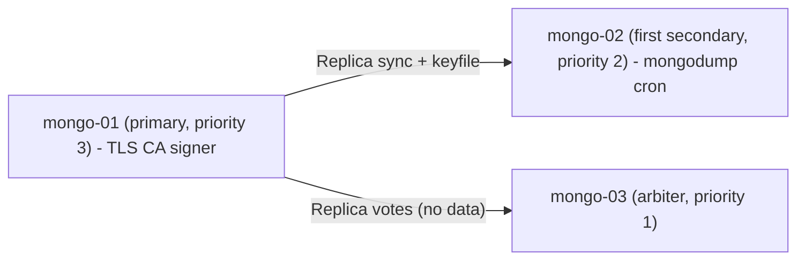

# Tutorial: Three-Node Replica Set and Automated TLS

> **Learning Goal:** Configure a 3-node PSA (Primary, Secondary, Arbiter) replica set with auto-generated keyfile authentication and self-signed TLS certificates in a local sandbox.
>
> **Environment Warning:** Self-signed CA artifacts are for isolated training and Molecule scenarios (`tls-ubi9`, `replicaset-psa-ubi9`). Use organization-issued certificates in production.

## Prerequisites

- Working local Docker lab (`docker/`) or three UBI 8/9 containers managed by Molecule
- Non-default secrets configured for `mongodb_admin_pass`, `mongodb_adminuser_pass`, and `mongodb_backup.pass`
- Odd number of hosts (`host_count | int % 2 != 0`) reachable on TCP port `27017`

## Architecture of the Lab Topology



## Step 1: Prepare an Odd-Numbered Inventory

Define one primary, one secondary, and one arbiter so `roles/mongod/tasks/assert.yml` confirms cluster quorum:

```ini
[mongodb_primary]
mongo-01.local mongodb_replication_role=primary

[mongodb_secondary]
mongo-02.local mongodb_replication_role=secondary

[mongodb_arbiter]
mongo-03.local mongodb_replication_role=arbiter
```

## Step 2: Set Replica Set, Keyfile, and TLS Variables

Store shared cluster variables cleanly (override default `"change_me"` secrets first):

```yaml
mongodb_version: "6.0"
mongodb_admin_pass: "lab_admin_secret"
mongodb_adminuser_pass: "lab_useradmin_secret"
mongodb_replication:
  replSetName: rs0
mongodb_security:
  authorization: enabled
  keyFile: /etc/mongodb.key
mongodb_tls_generate_certs: true
mongodb_tls_dir: /etc/ssl/mongodb
mongodb_backup:
  enabled: true
  pass: "lab_backup_secret"
```

## Step 3: Deploy with `playbooks/install_mongodb.yml`

Run the standard role playbook against your lab inventory:

```bash
ansible-playbook -i hosts.ini playbooks/install_mongodb.yml -e "@cluster_vars.yml"
```

During execution, the role runs `keyfile.yml` to distribute `/etc/mongodb.key`, `user_init.yml` to bootstrap `admin`/`adminuser`/`backup`, `cluster.yml` to call `community.mongodb.mongodb_replicaset`, and `tls.yml` to generate CA-signed node PEM files.

## Step 4: Verify Replica Set and TLS Connections

Check replica set state from the primary node over TLS:

```bash
mongosh --tls --host localhost --port 27017 \
  --tlsCAFile /etc/ssl/mongodb/mongodb-ca.crt \
  --tlsCertificateKeyFile /etc/ssl/mongodb/mongodb.pem \
  -u admin -p lab_admin_secret --authenticationDatabase admin \
  --quiet --eval "rs.status().members.map(m => m.name + ': ' + m.stateStr)"
```

Expected output:

```text
[ 'mongo-01.local:27017: PRIMARY', 'mongo-02.local:27017: SECONDARY', 'mongo-03.local:27017: ARBITER' ]
```

## Next Steps

- Production runbooks in ASD-STE100: [How-To Guides](../02-how-to-guides/index.md)
- Variable reference table: [Variables, Playbooks, and Scenarios](../03-reference/variables-playbooks-and-scenarios.md)
- Deep dive on role ordering and quorum: [Role Architecture and Quorum Design](../04-explanation/role-architecture-and-quorum-design.md)
