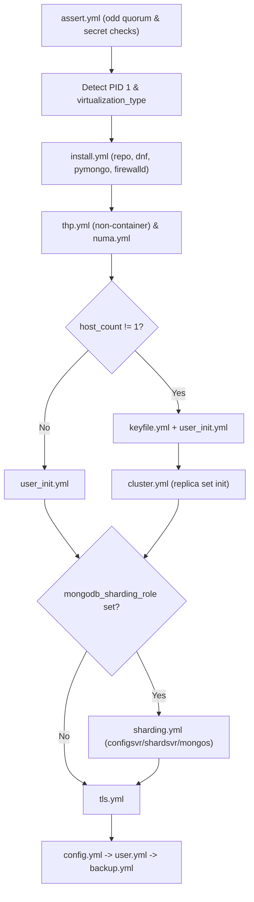

# Role Architecture and Quorum Design

## Role Execution Pipeline

`roles/mongod/tasks/main.yml` executes installation, kernel tuning, security initialization, clustering, sharding, TLS provisioning, configuration templating, user provisioning, and backup scheduling in a strict sequence.

Early assertion validation prevents partial package installations or unauthenticated replica set formation when required secrets remain set to `"change_me"`.

## Service Management Dual Path (`systemd` vs. `supervisord`)

Production Enterprise Linux 8/9 VMs run `systemd` as PID 1, whereas minimal UBI containers lack a booted `systemd` daemon or writeable cgroup controllers.

| Aspect | Native Host (`mongodb_is_systemd: true`) | Container Fallback (`mongodb_is_systemd: false`) | Override Flag |
| :--- | :--- | :--- | :--- |
| Detection source | `ps -p 1 -o comm=` equals `systemd` | Non-systemd PID 1 process | `mongodb_is_systemd` |
| Process supervisor | `ansible.builtin.service` (`mongod` / `mongos`) | `tasks/supervisor.yml` (`supervisord` + `supervisorctl`) | `mongodb_manage_service` |
| Process fork mode (`mongod_init.conf.j2`) | `fork: true` | `fork: false` | Automatic via Jinja |
| Kernel tuning (`thp.yml`, `numa.yml`) | Executed when `mongodb_thp`/`mongodb_numa` enabled | Skipped for container virtualization | Automatic |

Because container-based Molecule scenarios (`default`, `sharding-ubi9`) cannot bind host cgroups uniformly across runners, separating `mongodb_is_systemd` from `mongodb_manage_service` lets Molecule test configuration generation without failing on host `systemd`.

## Architecture Decision Record: Strict Odd-Node Quorum Check

| Attribute | Value |
| :--- | :--- |
| **Status** | Accepted (Enforced in `roles/mongod/tasks/assert.yml`) |
| **Constraints** | Distributed elections require majority voting members without manual intervention |
| **Implementation** | `host_count \| int % 2 != 0` with at most one primary and one arbiter |

### Options and Trade-Offs

| Topology Option | Fault Tolerance | Write Quorum Safety | Assertion Support | Verdict |
| :--- | :--- | :--- | :--- | :--- |
| 1-Node Standalone | None (single host) | Not replicated | Allowed (`host_count == 1`) | **Supported** (dev/single) |
| 3-Node PSA (Primary + Secondary + Arbiter) | Tolerates 1 node loss | Safe (`2/3` votes) | Allowed (`primary_list == 1`, `arbiter_list <= 1`) | **Supported** |
| 3-Node or 5-Node PSS | Tolerates 1 or 2 node losses | Full data majority | Allowed (`arbiter_list == 0`) | **Supported** |
| 2-Node or 4-Node Even Cluster | Breaks majority on split | Split-brain / read-only freeze | Rejected by `assert.yml` | **Rejected** |

### Consequences

- Operators attempting 2-node or 4-node replica sets fail immediately during preflight assertions rather than losing write quorum after deployment.
- Sharded clusters require separate group roles (`configsvr`, `shardsvr`, `mongos`) so config servers and shard replica sets each keep an odd member count (`sharding-ubi9` uses 3 `configsvr`, 3 `shardA`, 3 `shardB`, and 1 `mongos`).

## First-Secondary Backup Placement

`roles/mongod/tasks/backup.yml` schedules `mongodump` cron jobs on either a standalone node or exclusively the first secondary host in `play_hosts` (`backup_on_host`), avoiding backup I/O overhead on the primary writer while avoiding redundant dumps across remaining secondaries.

## Related Documentation

- Variable defaults and playbooks: [Variables, Playbooks, and Scenarios](../03-reference/variables-playbooks-and-scenarios.md)
- Operational runbooks: [Deploy Replica Set and Sharding](../02-how-to-guides/deploy-replica-set-and-sharding.md)
- Upgrade, backup, and TLS procedures: [Backup, Upgrade, and TLS Operations](../02-how-to-guides/backup-upgrade-and-tls-operations.md)
